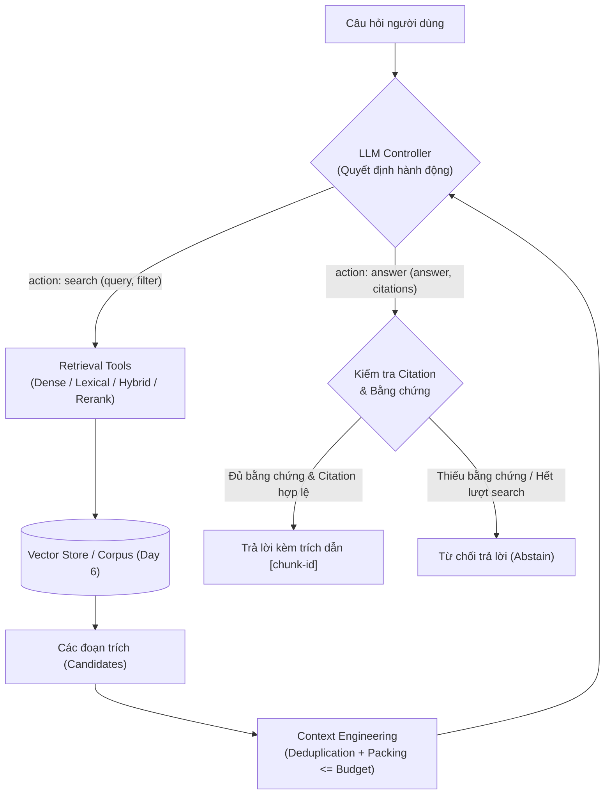

# Phân tích Nội dung & Mục tiêu Học tập — Day 7: Agentic RAG & Context Engineering

Tài liệu này tổng hợp và phân tích toàn diện toàn bộ nội dung từ các tệp hướng dẫn trong kho lưu trữ, chỉ rõ **những kiến thức lý thuyết cần hiểu** và **các nhiệm vụ thực hành cần triển khai** đối với sinh viên sau khi hoàn thành bài thực hành Day 7.

--- 

## 1. Bức tranh Tổng quan & Triết lý Thiết kế

Bài thực hành **Day 7** tiếp nối trực tiếp từ **Day 6** (nơi sinh viên đã học cách chunking tài liệu, sinh embedding và lưu vào vector store). Mục tiêu cốt lõi của Day 7 là chuyển dịch từ **Naive/Pipeline RAG** (mô hình tuyến tính một chiều: nhận câu hỏi $\rightarrow$ tìm vector $\rightarrow$ đưa vào prompt $\rightarrow$ sinh câu trả lời) sang **Agentic RAG**:
- Mô hình ngôn ngữ lớn (LLM) đóng vai trò trung tâm (**Controller**) tự điều phối việc tìm kiếm thông tin bằng công cụ (**Tool calling**).
- Hệ thống hỗ trợ tìm kiếm nhiều bước (**multi-hop / multi-turn retrieval**) để tổng hợp chứng cứ.
- Quản trị ngân sách ngữ cảnh (**Context Engineering**) chặt chẽ nhằm tối ưu hóa chi phí token và độ trễ.
- Đảm bảo tính trung thực: Câu trả lời bám sát bằng chứng (**Grounding**), có trích dẫn nguồn (**Citation**) và biết tự từ chối khi không đủ thông tin (**Abstention**) thay vì phỏng đoán sinh ảo giác.

---

## 2. Những kiến thức LÝ THUYẾT sinh viên cần nắm vững

### 2.1. Kiến trúc Agentic RAG & Cơ chế Vòng lặp Quyết định (Decision-Making Loop)
* **Khác biệt cốt lõi giữa Pipeline RAG và Agentic RAG:**
  * Pipeline RAG thụ động chỉ thực hiện một lần truy vấn duy nhất.
  * Agentic RAG xây dựng một vòng lặp ReAct / Controller-Tool: LLM tự phân tích xem thông tin hiện có đã đủ để trả lời chưa; nếu chưa, nó tiếp tục tạo câu truy vấn mới để tìm kiếm tiếp.
* **Cơ chế Dừng (Termination Conditions) & An toàn vòng lặp (Guardrails):**
  * Hiểu nguy cơ bẫy lặp vô tận (infinite retrieval loop) của Agent khi không tìm thấy thông tin hoặc bị kẹt trong logic suy luận.
  * Thiết kế điều kiện dừng dựa trên: số lượt tìm kiếm tối đa (`max_searches`), ngưỡng ngân sách ngữ cảnh (`budget limit`), hoặc khi Agent tự đánh giá thông tin đã hội tụ.

### 2.2. Các Phương pháp Truy xuất & Kỹ thuật Xếp hạng (Retrieval Paradigms)
Sinh viên cần hiểu rõ nguyên lý toán học và đặc trưng kỹ thuật của ít nhất 3 họ phương pháp retrieval:
* **Dense Retrieval (Truy xuất ngữ nghĩa):** Dựa trên cosine similarity / inner product giữa vector câu hỏi và vector chunks đã lưu trong Vector Store Day 6. Rất mạnh về tìm kiếm tương đồng ý niệm, ngữ nghĩa trừu tượng, nhưng dễ trượt các từ khóa chuyên ngành hiếm hoặc mã số cụ thể.
* **Lexical / Sparse Retrieval (Truy xuất từ khóa):** Dựa trên tần suất từ (TF-IDF, BM25). Hiểu tầm quan trọng của giai đoạn tiền xử lý văn bản, chuẩn hóa Unicode (NFC), tokenization (đặc biệt là kỹ thuật tách từ tiếng Việt). Rất mạnh về tìm đúng từ khóa, mã số, thực thể tên riêng.
* **Hybrid Retrieval (Truy xuất lai):** Kết hợp đồng thời Dense và Lexical. Sinh viên cần hiểu:
  * Không thể cộng trực tiếp điểm số thô của BM25 với điểm Cosine của Vector Search vì phân phối điểm và thang đo hoàn toàn khác nhau.
  * Các kỹ thuật dung hợp: **RRF (Reciprocal Rank Fusion)** dựa trên thứ hạng rank, hoặc **Score Fusion** sau khi đã chuẩn hóa min-max / z-score.
* **Re-ranking (Mô hình xếp hạng lại hai giai đoạn):**
  * Stage 1: Dùng Bi-Encoder (hoặc BM25) với chi phí thấp để quét nhanh lấy top-$k$ ứng viên (ví dụ $k=20-50$).
  * Stage 2: Dùng Cross-Encoder / Reranker model đắt hơn để tính toán cross-attention chi tiết giữa query và chunk, xếp hạng lại top đầu.
* **Query Transformation & Multi-hop Reasoning:**
  * Kỹ thuật viết lại câu truy vấn (Query Rewriting), mở rộng truy vấn (Query Expansion), hoặc phân rã câu hỏi lớn thành các câu hỏi con (Sub-query Decomposition) nhằm phục vụ các bài toán cần tổng hợp thông tin từ nhiều trang/nguồn khác nhau.

### 2.3. Kỹ nghệ Ngữ cảnh (Context Engineering)
* **Quản trị Ngân sách Ngữ cảnh (Context Budget Management):** Ngữ cảnh đưa vào prompt bị giới hạn bởi token/ký tự. Đưa quá ít thì thiếu bằng chứng, đưa quá nhiều thì tốn chi phí, tăng độ trễ và dẫn tới hiện tượng "Lost in the Middle".
* **Đóng gói & Khử trùng lặp (Packing & Deduplication):** Thuật toán ghép nối chunk sau nhiều lượt search: nhận diện và loại bỏ các chunk trùng lặp (`seen chunks`), sắp xếp theo độ liên quan, gắn kèm metadata định danh (`[chunk-id | source | page]`).
* **Bão hòa ngữ cảnh (Context Saturation):** Hiểu rằng nếu các chunk từ lần tìm kiếm đầu tiên chiếm gần hết budget thì các chunk phát hiện ở các bước sau sẽ bị loại bỏ, dẫn đến việc Agent không bổ sung thêm được bằng chứng mới.

### 2.4. Bằng chứng, Chống ảo giác và Cơ chế Từ chối (Grounding & Abstention)
* **Grounded Answer:** Câu trả lời của LLM phải được hậu thuẫn hoàn toàn bởi ngữ cảnh được cung cấp (evidence-backed), không dựa vào kiến thức học sẵn (parametric memory) chưa được kiểm chứng.
* **Tính hợp lệ của Citation (Cú pháp vs Ngữ nghĩa):**
  * *Cú pháp (Syntactic):* Định dạng citation `[chunk-id]` hợp lệ và ID đó có nằm trong context đã gửi cho model.
  * *Ngữ nghĩa (Semantic):* Nội dung của chunk đó thực sự chứng minh cho mệnh đề mà mô hình đưa ra. Một citation ID đúng về mặt kỹ thuật vẫn có thể sai về mặt ngữ nghĩa nếu mô hình gán bừa.
* **Cơ chế Từ chối (Abstention / Knowing What You Don't Know):**
  * Trong môi trường sản xuất, việc mô hình thừa nhận *"Không đủ bằng chứng để trả lời"* có giá trị an toàn cao hơn rất nhiều so với việc tạo ra câu trả lời phỏng đoán sai lệch (hallucination).
  * Hiểu bài toán đánh giá tính năng từ chối: Đo lường cả tỷ lệ từ chối đúng trên câu thiếu bằng chứng lẫn tỷ lệ từ chối nhầm trên câu có bằng chứng (False Abstention).

### 2.5. Phương pháp luận Nghiên cứu & Đánh giá Thực nghiệm (Evaluation Methodology)
* **Nguyên tắc phân chia Dev/Test (Data Leakage Prevention):**
  * Tập **Dev**: Dùng để thử nghiệm, so sánh các cấu hình, phân tích lỗi và tối ưu tham số.
  * Tập **Test**: Giữ kín hoàn toàn (held-out). Chỉ sau khi đã chốt cấu hình và đóng băng pipeline trên Dev mới được phép chạy trên Test để có đánh giá khách quan. Tuyệt đối không tinh chỉnh hệ thống dựa trên kết quả của Test set.
* **Hệ thống chỉ số đo lường toàn diện:**
  * *Retrieval Metrics:* `Hit@1`, `Evidence Hit@3`, `Recall@k`, `MRR`.
  * *Context Metrics:* `Context Evidence Rate` (tỷ lệ câu hỏi mà context sau khi pack thực sự chứa đủ bằng chứng hợp lệ).
  * *Agent & Answer Metrics:*
    * `Tool use rate`: Tần suất gọi tool retrieval trên tổng số câu.
    * `Grounded Answer score`: Thang điểm 3 mức (0: sai/thiếu bằng chứng; 1: đúng một phần; 2: đúng và đủ).
    * `Citation validity`: Tỷ lệ citation thực sự hỗ trợ câu trả lời.
    * `Abstention accuracy`: Tỷ lệ từ chối chính xác trên các câu không có lời giải.
    * `False abstention rate`: Tỷ lệ từ chối nhầm các câu vốn dĩ có bằng chứng.
* **Sự đánh đổi trong kỹ thuật (Engineering Trade-offs):** Phân tích tương quan giữa **Độ chính xác (Quality)** $\leftrightarrow$ **Thời gian phản hồi (Latency)** $\leftrightarrow$ **Chi phí tài nguyên (Cost/Token)**.

### 2.6. Xử lý Tài liệu Đa phương thức Thực tế (Multimodal Complex Documents — Nâng cao)
* Hiểu cấu trúc của tài liệu thực tế dạng báo cáo thường niên, tài liệu nghiên cứu (>100 trang): nội dung quan trọng không chỉ nằm ở text thuần mà nằm ở **Bảng biểu (Tables)**, **Hình ảnh/Sơ đồ (Images/Diagrams)**, và **Đồ thị (Charts)**.
* Nắm được nguyên lý của các công cụ xử lý: OCR, Phân tích bố cục (Layout Analysis), Trích xuất bảng (Table Extraction), Multimodal Embeddings và Vision-Language Models (VLM).

---

## 3. Những nội dung THỰC HÀNH sinh viên phải triển khai

| Giai đoạn | Nhiệm vụ cụ thể | Đầu ra / Bằng chứng | Tệp tham chiếu |
|---|---|---|---|
| **1. Hạ tầng** | Kết nối Vector store & Embedding model Day 6; chuẩn bị tập tài liệu (tối thiểu 30 trang cho bài cơ bản). | Adapter kết nối, kiểm tra tính tương thích vector dimension giữa query và index. | [starter/convert_day6.py](file:///Users/minh/GitHub-PMinh/K5-L3B-DAY07-2A202604114-PhamHoangDucMinh-RetrievalContext/starter/convert_day6.py), [data/README.md](file:///Users/minh/GitHub-PMinh/K5-L3B-DAY07-2A202604114-PhamHoangDucMinh-RetrievalContext/data/README.md) |
| **2. Benchmark** | Xây dựng bộ benchmark tối thiểu 24 câu (Dev: 15 câu có đáp án + 2 câu thiếu evidence; Test: 5 câu có đáp án + 2 câu thiếu evidence). | File `questions.json` và `cases.json` chuẩn hóa schema (gồm gold source_id, page, evidence_quote). | [BENCHMARK.md](file:///Users/minh/GitHub-PMinh/K5-L3B-DAY07-2A202604114-PhamHoangDucMinh-RetrievalContext/BENCHMARK.md) |
| **3. Retrieval** | Triển khai và đo lường ít nhất 3 phương pháp retrieval khác nhau trên cùng tập Dev (gồm Dense retrieval Day 6, TF-IDF/BM25, Hybrid, Reranking,...). | Bảng so sánh `Hit@1`, `Evidence Hit@3`, `Context Evidence Rate`, độ trễ và chi phí. | [GUIDE.md](file:///Users/minh/GitHub-PMinh/K5-L3B-DAY07-2A202604114-PhamHoangDucMinh-RetrievalContext/GUIDE.md), [starter/baseline.py](file:///Users/minh/GitHub-PMinh/K5-L3B-DAY07-2A202604114-PhamHoangDucMinh-RetrievalContext/starter/baseline.py) |
| **4. Agent Loop** | Xây dựng Agent hoàn chỉnh với model thật (OpenAI, Gemini, Claude, Ollama...): cài đặt `Controller.decide`, gọi tool `Retriever.search`, đóng gói context theo ngân sách. | Mã nguồn Agent, cơ chế lưu trữ trace toàn bộ quá trình tương tác (events, queries, results, context). | [starter/agentic.py](file:///Users/minh/GitHub-PMinh/K5-L3B-DAY07-2A202604114-PhamHoangDucMinh-RetrievalContext/starter/agentic.py) |
| **5. Cải tiến & Lỗi** | Đặt giả thuyết kỹ thuật và thử nghiệm ít nhất 2 cấu hình cải tiến trên Dev. Đọc sâu và mổ xẻ nguyên nhân của ít nhất 2 ca lỗi (error cases). | Báo cáo giả thuyết trước/sau, phân tích nguyên nhân gốc rễ và tiêu chí chọn cấu hình tối ưu. | [REPORT_TEMPLATE.md](file:///Users/minh/GitHub-PMinh/K5-L3B-DAY07-2A202604114-PhamHoangDucMinh-RetrievalContext/REPORT_TEMPLATE.md) |
| **6. Đánh giá Test** | Đóng băng cấu hình đã chọn, chạy trên tập Test. Tự đọc và thẩm định thủ công (manual audit) từng câu: chấm điểm câu trả lời (0/1/2), kiểm tra semantic citation, kiểm tra từ chối. | File `reviews.json`, chạy [starter/agent_metrics.py](file:///Users/minh/GitHub-PMinh/K5-L3B-DAY07-2A202604114-PhamHoangDucMinh-RetrievalContext/starter/agent_metrics.py) để xuất báo cáo tổng hợp. | [BENCHMARK.md](file:///Users/minh/GitHub-PMinh/K5-L3B-DAY07-2A202604114-PhamHoangDucMinh-RetrievalContext/BENCHMARK.md), [starter/agent_metrics.py](file:///Users/minh/GitHub-PMinh/K5-L3B-DAY07-2A202604114-PhamHoangDucMinh-RetrievalContext/starter/agent_metrics.py) |
| **7. Nâng cao (+15đ)** | *(Tùy chọn)* Index tài liệu >100 trang có bảng/ảnh/biểu đồ. Xây dựng benchmark test 30 câu (Text, Table, Image, Chart, Multi-hop, Abstain). Đạt $\ge$ 90% (27/30 câu). | Toàn bộ pipeline multimodal, trace chi tiết từng câu, ảnh crop/vùng tọa độ chứng minh. | [ADVANCED.md](file:///Users/minh/GitHub-PMinh/K5-L3B-DAY07-2A202604114-PhamHoangDucMinh-RetrievalContext/ADVANCED.md) |
| **8. Báo cáo** | Hoàn thiện báo cáo cá nhân theo mẫu chuẩn, trình bày kết quả, biểu đồ/bảng số liệu, giới hạn hệ thống và bài học kinh nghiệm. | Tệp báo cáo `report/individual/MSSV_HoTen.md` được điền đầy đủ và đẩy lên repo cá nhân. | [report/individual/MSSV_HoTen.md](file:///Users/minh/GitHub-PMinh/K5-L3B-DAY07-2A202604114-PhamHoangDucMinh-RetrievalContext/report/individual/MSSV_HoTen.md), [SUBMISSION.md](file:///Users/minh/GitHub-PMinh/K5-L3B-DAY07-2A202604114-PhamHoangDucMinh-RetrievalContext/SUBMISSION.md) |

---

## 4. Bảng Tra cứu Tài liệu trong Repository

Để thuận tiện trong quá trình làm bài, sinh viên có thể truy cập trực tiếp các tài liệu chuyên biệt dưới đây:

* [README.md](file:///Users/minh/GitHub-PMinh/K5-L3B-DAY07-2A202604114-PhamHoangDucMinh-RetrievalContext/README.md): Tổng quan bài tập và yêu cầu đầu vào.
* [GUIDE.md](file:///Users/minh/GitHub-PMinh/K5-L3B-DAY07-2A202604114-PhamHoangDucMinh-RetrievalContext/GUIDE.md): Hướng dẫn chi tiết từng bước kỹ thuật (chuẩn bị, thử nghiệm retrieval, xây dựng agent, đánh giá).
* [RUBRIC.md](file:///Users/minh/GitHub-PMinh/K5-L3B-DAY07-2A202604114-PhamHoangDucMinh-RetrievalContext/RUBRIC.md): Thang điểm chi tiết (85 điểm cơ bản + 15 điểm bonus nâng cao = 100 điểm).
* [BENCHMARK.md](file:///Users/minh/GitHub-PMinh/K5-L3B-DAY07-2A202604114-PhamHoangDucMinh-RetrievalContext/BENCHMARK.md): Quy chuẩn thiết kế bộ câu hỏi, định nghĩa các metric và phương pháp thẩm định.
* [ADVANCED.md](file:///Users/minh/GitHub-PMinh/K5-L3B-DAY07-2A202604114-PhamHoangDucMinh-RetrievalContext/ADVANCED.md): Quy định về thử thách tài liệu 100+ trang đa phương thức.
* [PSEUDOCODE.md](file:///Users/minh/GitHub-PMinh/K5-L3B-DAY07-2A202604114-PhamHoangDucMinh-RetrievalContext/PSEUDOCODE.md): Mã giả tóm tắt toàn bộ quy trình thực hiện.
* [RULES.md](file:///Users/minh/GitHub-PMinh/K5-L3B-DAY07-2A202604114-PhamHoangDucMinh-RetrievalContext/RULES.md): Các quy định học thuật, bảo mật API key và nguyên tắc đánh giá trung thực.
* [CHECKPOINTS.md](file:///Users/minh/GitHub-PMinh/K5-L3B-DAY07-2A202604114-PhamHoangDucMinh-RetrievalContext/CHECKPOINTS.md): Gợi ý phân bổ mốc thời gian thực hiện (4 giờ thực hành chuẩn).
* [SUBMISSION.md](file:///Users/minh/GitHub-PMinh/K5-L3B-DAY07-2A202604114-PhamHoangDucMinh-RetrievalContext/SUBMISSION.md): Hướng dẫn cách tạo repo cá nhân và danh mục nộp bài.
* [REPORT_TEMPLATE.md](file:///Users/minh/GitHub-PMinh/K5-L3B-DAY07-2A202604114-PhamHoangDucMinh-RetrievalContext/REPORT_TEMPLATE.md) / [MSSV_HoTen.md](file:///Users/minh/GitHub-PMinh/K5-L3B-DAY07-2A202604114-PhamHoangDucMinh-RetrievalContext/report/individual/MSSV_HoTen.md): Mẫu báo cáo cá nhân cần hoàn thiện.
* [starter/README.md](file:///Users/minh/GitHub-PMinh/K5-L3B-DAY07-2A202604114-PhamHoangDucMinh-RetrievalContext/starter/README.md): Hướng dẫn sử dụng mã nguồn khung mẫu (`agentic.py`, `baseline.py`, `agent_metrics.py`, `convert_day6.py`).
* [data/README.md](file:///Users/minh/GitHub-PMinh/K5-L3B-DAY07-2A202604114-PhamHoangDucMinh-RetrievalContext/data/README.md): Quy định cấu trúc schema JSON của Chunks, Questions và Gold labels.
